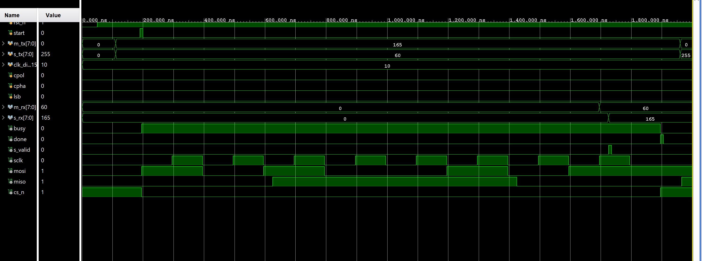

# SPI Master/Slave Controller with Self-Checking Verification (Verilog)

Parameterized SPI master and slave written in Verilog, verified with a self-checking
testbench in Xilinx Vivado (xsim), and synthesized/implemented for an Artix-7 (xc7a100t).

## Features

- SPI modes 0, 1, 2, 3 (CPOL/CPHA)
- Parameterized data width (`DATA_W`, up to 32)
- MSB-first or LSB-first
- Runtime-configurable SCLK divider (`SCLK = clk / (2 * clk_div)`)
- No derived clocks: SCLK is generated with a tick counter / clock enable
- Slave oversamples SCLK, MOSI and CS with the system clock through 2-FF synchronizers
  (no SCLK-as-clock CDC problem)

## Repository structure

```
rtl/
  spi_master.v   SPI master (FSM + tick counter)
  spi_slave.v    SPI slave (synchronizers + edge detection)
  spi_top.v      Master + slave wrapper, used for synthesis/implementation
tb/
  tb_spi.v       Self-checking testbench (master <-> slave loopback)
docs/            Simulation and implementation screenshots
```

## How it works

- **Master:** an IDLE / RUN / FIN FSM. A counter produces a tick every `clk_div` system
  clocks, and each tick toggles SCLK. Even edges are leading and odd edges are trailing;
  CPHA selects which edge samples MISO and which edge shifts MOSI.
- **Slave:** synchronizes SCLK, MOSI and CS_N, detects rising/falling edges, and uses
  CPOL/CPHA to pick the sample and shift edges. While CS_N is high it preloads the first
  MISO bit and resets its counters.

## Verification

`tb/tb_spi.v` connects the master and slave in loopback and checks both directions
automatically (master RX must equal slave TX, and slave RX must equal master TX).

- Directed tests: all 4 modes x MSB/LSB first x corner-case data (`00`, `FF`, `01`, `80`, `55`, `AA`, ...)
- Clock-divider sweep (`clk_div` = 6, 10, 25)
- 500 constrained-random transfers (random mode, bit order and data)
- Protocol monitor: exactly `2*DATA_W` SCLK edges per frame, SCLK idle level equals CPOL
  when CS_N falls
- Simple coverage counters per mode and bit order
- Prints a PASS/FAIL summary and an error count

**Result:** 588 transfers, 0 errors (see `docs/sim_pass_console.png`).

**Example transfer** (mode 0, MSB first, master sends `0xA5`, slave sends `0x3C`; values shown in decimal: 165 = `0xA5`, 60 = `0x3C`):



### Run the simulation (Vivado)

1. Create an RTL project (part `xc7a100tcsg324-1`, or any 7-series part).
2. Add `rtl/spi_master.v` and `rtl/spi_slave.v` as design sources, and `tb/tb_spi.v` as a simulation source.
3. Set `tb_spi` as the simulation top and run Behavioral Simulation.
4. In the Tcl console type `run all`. It should end with `*** TEST PASSED : 0 errors ***`.

## Implementation results

Vivado, Artix-7 xc7a100t, `spi_top` as top, 100 MHz target clock.

| Item | Result |
|---|---|
| LUTs (master + slave) | 105 (master 75, slave 30) |
| Flip-flops | 106 (master 63, slave 43) |
| Setup WNS @ 100 MHz | +2.556 ns (timing met) |
| Estimated Fmax | about 134 MHz (1000 / (10 - 2.556)) |

Screenshots are in `docs/`.

Notes on these numbers:
- The clock was defined in the Tcl console after implementation
  (`create_clock -period 10.000 -name sys_clk [get_ports clk]`), so placement was not
  timing-driven. Treat Fmax as an estimate.
- The critical path is the master's `cnt == clk_div - 1` compare feeding the enables of
  the data registers (high fanout, routing-dominated).
- Power was not analysed.

## Limitations

- Not tested on hardware (simulation and implementation only).
- The slave oversamples SCLK, so the system clock must be at least about 6x SCLK
  (`clk_div >= 6`).
- The master does not synchronize MISO. A real board would need a 2-FF synchronizer
  on MISO and a CS setup delay.
- Single slave, single chip select. MISO is not tri-stated when CS is inactive.
- `tx_data` and the configuration inputs must stay stable while a transfer is in progress.

## Possible extensions

- I2C master and slave with clock stretching
- SystemVerilog assertions and functional covergroups
- FIFOs and a register interface (APB / AXI4-Lite)
- Fix the critical path by registering the tick compare
- Hardware demo and ILA capture on an FPGA board

## License

MIT, see `LICENSE`.
